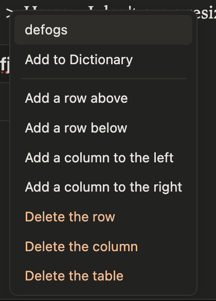

1. [ ] There is no point turning annotations on when you can keep the settings for comments and coding off\
   *I'm planning a lot more for the annotations plugin, including splitting comments and codes into different plugins that are managed independently. I need to rejigger the architecture before that though, so this is just temporary.*
2. [ ] It's kinda hard to see the difference between bold and not bold text on dark mode...\
   *This will come with a larger css/styles component.*
3. [ ] I have speechify AI (I hate it) that just reads whats on my screen. The placeholder "start writing..." triggers it and my AI attempts to rephrase it to make it more grammatically correct. Third party programs should see that as placeholder, not normal text.\
   *Fixed in the next release*
4. [ ] The text box for the synopsis on the coarkboard has a little resize indicator even though it doesn't do anything (at least on the app)\
   *Fixed in the next release*
5. [ ] You need a way to resize an image
6. [ ] You have currently 2 systems for dictionaries, the built-in apple one and the one you have... not sure if they both use the same backend system or if it's just using different popups...

